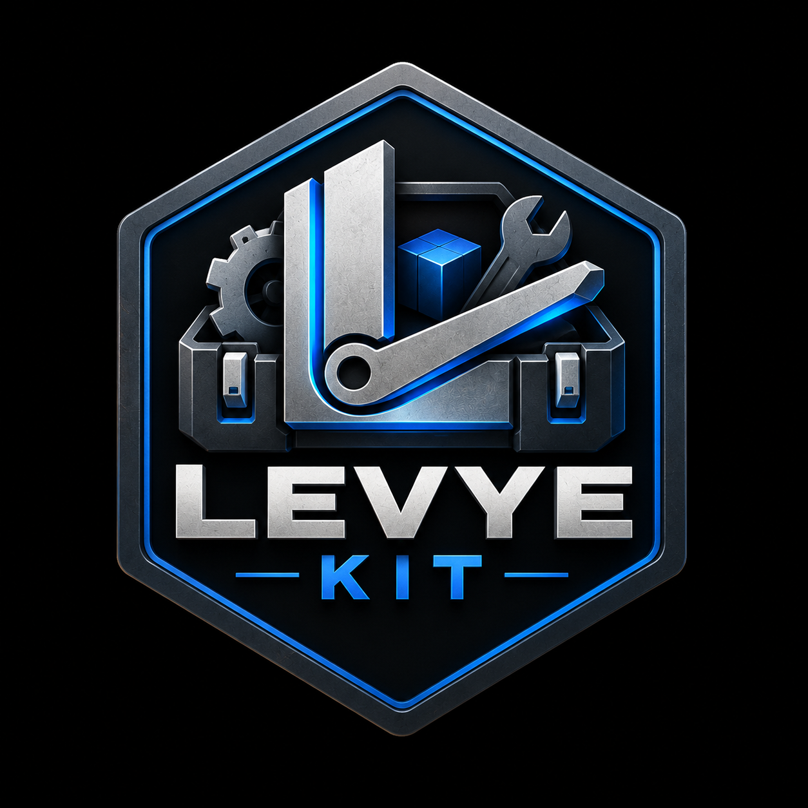
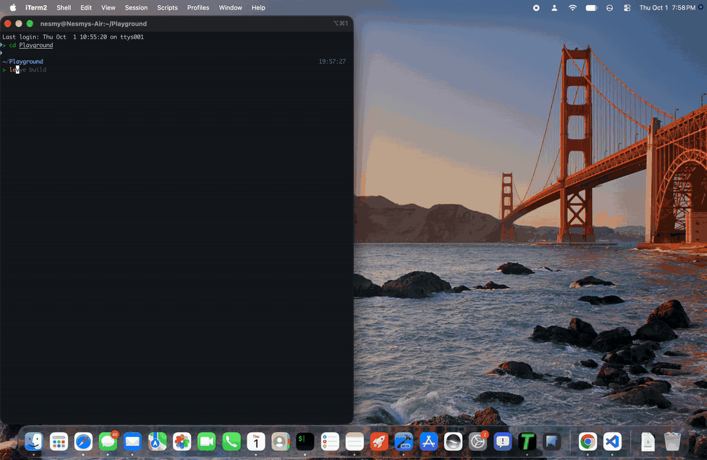
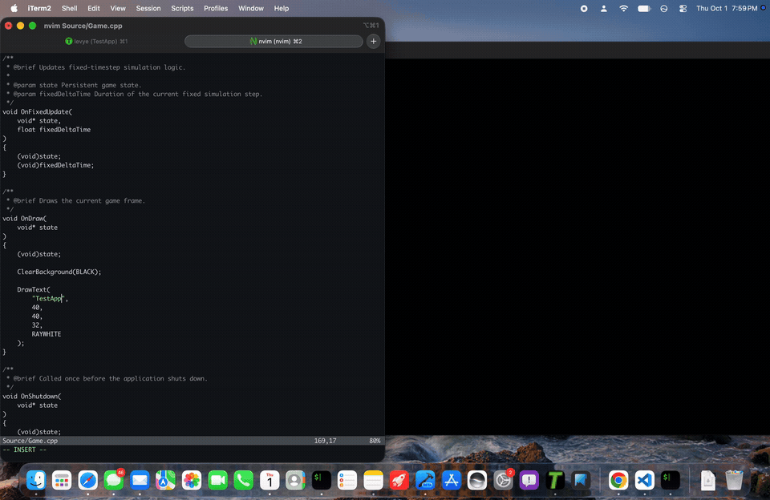

<a id="readme-top"></a>

<!-- PROJECT SHIELDS -->

[![Contributors][contributors-shield]][contributors-url]
[![Forks][forks-shield]][forks-url]
[![Stargazers][stars-shield]][stars-url]
[![Issues][issues-shield]][issues-url]

<!-- PROJECT LOGO -->

<br />

<div align="center">
  <a href="https://github.com/Levye-Studio/LevyeKit">
    
  </a>

  <h3 align="center">LevyeKit</h3>

  <p align="center">
    A lightweight C++ game framework built on raylib for Levye Studio games.
    <br />
    <a href="#usage-api"><strong>Explore the docs »</strong></a>
    <br />
    <br />
    <a href="#getting-started">Get Started</a>
    &middot;
    <a href="https://github.com/Levye-Studio/LevyeKit/issues/new?labels=bug">Report Bug</a>
    &middot;
    <a href="https://github.com/Levye-Studio/LevyeKit/issues/new?labels=enhancement">Request Feature</a>
  </p>
</div>

<!-- TABLE OF CONTENTS -->

<details>
  <summary>Table of Contents</summary>
  <ol>
    <li>
      <a href="#about-the-project">About The Project</a>
      <ul>
        <li><a href="#built-with">Built With</a></li>
        <li><a href="#design-philosophy">Design Philosophy</a></li>
      </ul>
    </li>
    <li><a href="#showcase">Showcase</a></li>
    <li>
      <a href="#getting-started">Getting Started</a>
      <ul>
        <li><a href="#prerequisites">Prerequisites</a></li>
        <li><a href="#installation">Installation</a></li>
        <li><a href="#creating-a-game">Creating a Game</a></li>
      </ul>
    </li>
    <li>
      <a href="#levye-cli">Levye CLI</a>
    </li>
    <li>
      <a href="#usage-api">Usage API</a>
      <ul>
        <li><a href="#public-api">Public API</a></li>
        <li><a href="#serialization">Serialization</a></li>
        <li><a href="#dear-imgui">Dear ImGui</a></li>
        <li><a href="#animation">Animation</a></li>
        <li><a href="#physics">Physics</a></li>
        <li><a href="#architecture">Architecture</a></li>
        <li><a href="#game-api">Game API</a></li>
        <li><a href="#hot-reloading">Hot Reloading</a></li>
        <li><a href="#state-preservation">State Preservation</a></li>
        <li><a href="#raylib-access">raylib Access</a></li>
        <li><a href="#repository-layout">Repository Layout</a></li>
      </ul>
    </li>
    <li><a href="#platforms">Platforms</a></li>
    <li><a href="#roadmap">Roadmap</a></li>
    <li><a href="#contributing">Contributing</a></li>
    <li><a href="#license">License</a></li>
    <li><a href="#contact">Contact</a></li>
  </ol>
</details>

<!-- ABOUT THE PROJECT -->

## About The Project

LevyeKit is a lightweight C++ game development framework built on top of [raylib](https://www.raylib.com/).

It is being developed as the reusable foundation for games made by **Levye Studio**.

The goal is not to replace raylib or become another large game engine. LevyeKit handles the common project infrastructure that would otherwise need to be recreated for every game while keeping raylib directly accessible to game code.

LevyeKit provides reusable systems for:

* Application lifecycle
* Native C++ game modules
* Code hot reloading
* Persistent game state
* Optional framework modules
* YAML game-data serialization
* Optional Dear ImGui debugging UI
* Optional skeletal animation and animation state machines
* Optional Jolt Physics: rigid bodies, collision queries, constraints, and virtual characters
* Keyboard, mouse, and gamepad input
* Texture, shader, and font management
* Asset hot reloading
* Audio and music management
* Screen management
* Time and fixed-step simulation
* Project configuration
* Debug and Release configurations
* Project generation
* Command-line development workflow

The framework stays intentionally small so games can use raylib directly whenever it already provides the required functionality.

> **Status:** LevyeKit **v0.5.0** introduces an optional Jolt Physics module with rigid bodies, collision queries, virtual character controllers, constraints, and runtime diagnostics. Linux and Windows validation remain outstanding. Physics API v7 requires rebuilding modules compiled against v6. See the [Physics guide](Docs/Physics-v0.5.0.md) and [Animation guide](Docs/Animation-v0.4.5.md).

<p align="right">(<a href="#readme-top">back to top</a>)</p>

### Built With

* [![C++][C++-shield]][C++-url]
* [raylib](https://www.raylib.com/)
* [CMake](https://cmake.org/)

<p align="right">(<a href="#readme-top">back to top</a>)</p>

### Design Philosophy

LevyeKit should stay small.

If raylib already provides something cleanly, LevyeKit should generally use it rather than wrapping it unnecessarily.

The framework exists to solve repeated infrastructure problems across Levye Studio games, not to hide the underlying technology.

Its main goals are:

* Keep raylib directly accessible
* Avoid repeating project setup for every game
* Provide a reusable application lifecycle
* Support native C++ hot reloading during development
* Preserve game state across compatible code reloads
* Keep resources owned by the stable application host
* Provide reusable input, serialization, audio, asset, shader, font, screen, and time systems
* Make creating and running a new game fast
* Keep the framework understandable
* Add systems only when games actually need them

LevyeKit deliberately avoids trying to become a full editor-driven engine.

<p align="right">(<a href="#readme-top">back to top</a>)</p>

<!-- SHOWCASE -->

## Showcase

### CLI Demo



### Hot Reload Demo



### Platformer3D Integration Demo

[Platformer3D](https://github.com/Levye-Studio/LevyeKit-Examples/tree/main/Demos/Platformer3D) demonstrates skeletal animation, Dear ImGui debugging, manual and Archive-based YAML serialization, and game-module hot reload together in a 3D platformer.

<p align="right">(<a href="#readme-top">back to top</a>)</p>

<!-- GETTING STARTED -->

## Getting Started

### Prerequisites

LevyeKit currently requires:

* Git
* CMake
* A C++20 compatible compiler

Platform-specific development tools may also be required depending on the target platform.

### Installation

Clone the repository:

```sh
git clone https://github.com/Levye-Studio/LevyeKit.git
cd LevyeKit
```

Configure a Debug build:

```sh
cmake -S . -B Build/Debug -DCMAKE_BUILD_TYPE=Debug
```

Build LevyeKit and its development tools:

```sh
cmake --build Build/Debug
```

The development CLI is built as:

```text
levye
```

Check the installed version:

```sh
levye --version
```

Or view the available commands:

```sh
levye --help
```

The included Sandbox can also be used to test framework systems and hot reloading.

<p align="right">(<a href="#readme-top">back to top</a>)</p>

### Creating a Game

Create a new LevyeKit game:

```sh
levye new MyGame
```

Create one and initialize a Git repository:

```sh
levye new MyGame --git
```

Or initialize Git and create the first commit:

```sh
levye new MyGame --commit
```

Then enter the generated project:

```sh
cd MyGame
```

Build it:

```sh
levye build
```

Run it:

```sh
levye run
```

A generated project contains the basic structure required to immediately start writing game code:

```text
MyGame/
├── Assets/
├── Source/
│   ├── CMakeLists.txt
│   ├── Game.cpp
│   └── Main.cpp
├── .gitignore
├── CMakeLists.txt
└── levye.project
```

Game-specific settings such as the project name, target, window configuration, and asset directory are stored in `levye.project`.

<p align="right">(<a href="#readme-top">back to top</a>)</p>

<!-- LEVYE CLI -->

## Levye CLI

LevyeKit includes a small command-line tool for the normal game-development workflow.

```text
levye new <name> [options]
levye add <module>
levye generate <type> <name> [options]
levye g <type> <name> [options]
levye build [options]
levye run [options]
levye clean [options]
levye project
levye upgrade [--dry-run|--check]
levye convert [path] [--dry-run|--check]

levye --help
levye --version
```

### Create

```sh
levye new MyGame
```

Optional Git integration:

```sh
levye new MyGame --git
levye new MyGame --commit
```

### Optional Modules

Enable optional modules when creating a project:

```sh
levye new MyGame --with imgui
levye new MyGame --with serialization --with imgui
levye new MyGame --with animation
levye new MyGame --with physics
```

Or enable a module in an existing project:

```sh
levye add imgui
levye add serialization
levye add animation
levye add physics
```

The CLI records enabled modules in `levye.project`:

```toml
[modules]
serialization = false
imgui = true
animation = true
physics = true
```

The generated project's CMake configuration reads these settings. Modules are
opt-in; projects without a module do not need its API in their game code.

The CLI records module choices in `levye.project`, and CMake reads them during configuration. Reconfigure after changing modules in an existing build directory.

### Build

Debug is the default configuration:

```sh
levye build
```

For Release:

```sh
levye build --release
```

### Run

Run an existing Debug build:

```sh
levye run
```

Or Release:

```sh
levye run --release
```

`levye run` does not implicitly rebuild the game. Build and run remain separate operations.

### Clean

Clean Debug output:

```sh
levye clean
```

Clean Release:

```sh
levye clean --release
```

Clean all generated build configurations:

```sh
levye clean --all
```

### Project

Display information about the current project:

```sh
levye project
```

The CLI searches parent directories for `levye.project`, allowing commands to be used from directories inside a game project.

### Upgrade an existing project

Run `levye upgrade --dry-run` to inspect proposed file changes, then `levye upgrade`
to apply them. `levye upgrade --check` is read-only and returns 0 when current,
2 when an upgrade is needed, or 1 for an unsupported project or error.

The upgrader recognizes the current source manifest and older literal
`add_library(Game SHARED Source/...)` source lists. It preserves source order,
custom CMake settings, game code, assets, project settings, and existing IDE
files. It adds the shared module configuration, generator markers, compile
commands export, missing IDE files, and a `project.template_version` schema
marker. This schema version is separate from the LevyeKit release version.

Projects with computed or ambiguous Game source lists, unrecognized custom
module configuration, missing ImGui linkage, different host or output layouts, or newer template
schema versions require manual migration. The command performs structural
validation and rolls back on a
validation failure; it does not run a full build.

### Convert a CMake C++ project

Run `levye convert [path] --dry-run` to review the conversion plan. `levye convert
[path] --check` makes no changes and exits 0 for an existing LevyeKit project, 2
when conversion is available, or 1 for an unsupported project or error. Run
`levye convert [path]` to apply the plan. The path defaults to the current
directory.

Automatic conversion supports a single C++20 CMake target: a static/shared
library with literal source files, or a simple one-file raylib executable with
literal window settings and static drawing calls. The raylib converter moves
validated drawing calls into `GameAPI.OnDraw`; the host takes over the window
and frame loop. It leaves the original source untouched. For libraries, it
keeps the original library as a separate build target and creates a starter
game module. Assets and existing `.gitignore` contents are preserved. The
original CMake file is saved as `CMakeLists.levye-original.txt`.

Complex game loops, extra source files, external dependencies, and computed
CMake expressions require manual adaptation. The CLI explains why it declined
conversion. Generated CMake uses `LEVYE_ROOT` from `levye build`, or from a
user-supplied CMake variable/environment variable when invoking CMake directly.
Conversion validates generated structure and rolls back failed writes; build
and runtime behavior still require project-specific verification.

Command-specific help is also available:

```sh
levye new --help
levye add --help
levye generate --help
levye g --help
levye build --help
levye run --help
levye clean --help
levye project --help
levye upgrade --help
levye convert --help
```

### Code Generation

LevyeKit includes a built-in C++ code generator for creating classes, source files, headers, and folders directly inside a game project.

#### Generate a class

```bash
levye generate class Player
```

Creates:

```text
Source/
├── Player.hpp
└── Player.cpp
```

Nested paths are supported:

```bash
levye generate class Systems/Physics
```

Creates `Source/Systems/Physics.hpp` and `Source/Systems/Physics.cpp`.

#### Other generation commands

```bash
levye generate source Gameplay/Combat
levye generate header Core/Constants
levye generate folder Levels
```

The shorter `g` alias is also supported:

```bash
levye g class Player
```

#### Generator options

| Option | Description |
|---|---|
| `--force` | Overwrite existing generated files |
| `--no-cmake` | Skip CMake source registration |

Generated `.cpp` files are automatically registered in `Source/CMakeLists.txt`, allowing them to be included in the game's next build. This manifest is included by the generated project's root `CMakeLists.txt`.

Existing files are protected by default. The generator also supports migration of compatible older LevyeKit project CMake layouts. File generation is staged and can roll back recoverable errors; it does not guarantee recovery from a process crash or power loss, and concurrent generation is not supported.

For the full command reference:

```bash
levye generate --help
```

<p align="right">(<a href="#readme-top">back to top</a>)</p>

<!-- USAGE API -->

## Usage API

### Public API

Game code can include the main LevyeKit header:

```cpp
#include <Levye/LevyeKit.hpp>
```

The primary game-facing APIs are:

```cpp
Levye::Log
Levye::Input
Levye::Screen
Levye::Time
Levye::Assets
Levye::Audio
Levye::Serialization // Optional module
Levye::Animation     // Optional module
Levye::Physics       // Optional module
```
Optional modules expose their APIs through their respective module headers.

For example:

```cpp
Levye::Log::Info("Game started.");

if (Levye::Input::IsPressed("Action"))
{
    // Handle the action.
}

Levye::Screen::Set("Gameplay");

Levye::Time::SetPaused(false);
```

Assets are represented by lightweight handles while the actual resources remain owned by the host:

```cpp
Levye::AssetHandle texture =
    Levye::Assets::LoadTexture("player.png");

const Texture2D* player =
    Levye::Assets::GetTexture(texture);
```

Audio follows the same model:

```cpp
Levye::AssetHandle sound =
    Levye::Audio::LoadSound("click.wav");

Levye::Audio::PlaySound(sound);
```

Individual LevyeKit headers remain available when a game prefers narrower includes.

### Input

Register bindings through the public `Levye::Input` API in `OnLoad()`. The
host owns the input map; reloadable modules access it only through
`HostServices`.

```cpp
// Keyboard, mouse, and controller inputs can represent the same action.
Levye::Input::BindKey("Action", KEY_SPACE);
Levye::Input::BindMouseButton("Action", MOUSE_BUTTON_LEFT);
Levye::Input::BindGamepadButton(
    "Action",
    0,
    GAMEPAD_BUTTON_RIGHT_FACE_DOWN
);

// WASD, arrow keys, and the first controller's left stick.
Levye::Input::BindKeyAxis("MoveX", KEY_A, KEY_D);
Levye::Input::BindKeyAxis("MoveX", KEY_LEFT, KEY_RIGHT);
Levye::Input::BindKeyAxis("MoveY", KEY_W, KEY_S);
Levye::Input::BindKeyAxis("MoveY", KEY_UP, KEY_DOWN);
Levye::Input::BindGamepadAxis(
    "MoveX",
    0,
    GAMEPAD_AXIS_LEFT_X,
    0.15f
);
Levye::Input::BindGamepadAxis(
    "MoveY",
    0,
    GAMEPAD_AXIS_LEFT_Y,
    0.15f
);
```

Actions use the combined state of every bound keyboard key, mouse button, and gamepad button:

- `IsDown()` is true while at least one binding is held.
- `IsPressed()` is true only when the action changes from up to down.
- `IsReleased()` is true only when the last held binding is released.

For W and UP bound to the same action: pressing W triggers one press, pressing
UP while W is held does not trigger another, releasing W while UP is held does
not release the action, and releasing UP finally triggers a release. A gamepad
button participates in exactly the same way. Disconnecting a gamepad removes
its contribution; reconnecting a held button may produce a new press.

The host calls `InputMap::Update()` once per frame, after raylib's event polling
and before reload callbacks, `OnUpdate`, fixed updates, and drawing. Queries
read one snapshot and never consume transitions. Repeated reads in the same
frame return the same result, including across a module reload. Handle one-shot
actions in `OnUpdate`; queue gameplay commands if fixed simulation needs them,
rather than handling the same edge in every fixed step. New bindings take
effect on the next host sample. Input remains active while game time is paused.

```cpp
void OnUpdate(void* state, float deltaTime)
{
    if (Levye::Input::IsPressed("Jump"))
    {
        // Queue one jump for the simulation.
    }
    const float horizontal = Levye::Input::GetAxis("MoveX");
    // Apply horizontal movement using deltaTime.
}
```

Keyboard axes combine directions across **all** bindings, without adding
multiple keys in the same direction:

| Keys | MoveX |
| --- | --- |
| A or Left | -1 |
| D or Right | +1 |
| A + Right | 0 |
| D + Left | 0 |
| A + Left | -1 |
| A + Left + Right | 0 |

After combining keyboard directions, the value with the greatest absolute
magnitude wins between that keyboard result and each available gamepad axis.
Ties prefer the keyboard, then the first registered gamepad binding. Thus A
beats a +0.7 stick value, while A + Right cancels the keyboard and allows +0.7
from the stick. Analog magnitudes below the deadzone are zero; other values
retain their magnitude without rescaling and are clamped to [-1, 1]. The default
deadzone is 0.15. Deadzones are clamped to [0, 1], with non-finite values replaced
by 0.15; non-finite analog samples are ignored. Disconnected controllers
contribute zero.

Bindings, axis values, and action history survive hot reload. `OnLoad` runs only
at startup, so bindings need not be recreated in `OnAfterReload`. Re-registering
an identical key, mouse button, key pair, or gamepad button is a no-op and does not reset held
state. Re-registering a gamepad axis updates its deadzone without adding a
second binding. Changed registrations can be applied in `OnAfterReload`, but
adding a replacement does not automatically remove an old binding.

```cpp
const Vector2 mouseDelta = Levye::Input::GetMouseDelta();
const float mouseWheel = Levye::Input::GetMouseWheel();

Levye::Input::ClearAction("Jump"); // Remove action bindings and state immediately.
Levye::Input::Clear();             // Remove all actions, axes, and cached values.
```

Mouse movement and wheel input are sampled once per host frame alongside actions and axes. `GetMouseDelta()` returns the frame's raw mouse movement, while `GetMouseWheel()` returns the raw wheel movement. These values are intentionally not exposed as named axes because LevyeKit's named axes are normalized to `[-1, 1]`, while mouse delta and wheel movement preserve their raw magnitude.

Clearing does not synthesize release events. `ClearAction` leaves a same-named
axis intact; there is currently no individual-axis removal function. A cleared
action starts fresh when rebound, so a held input generates a press on its next
sample. Do not call `Clear()` on every reload. Null action/axis names and calls
without bound services are safe no-ops (queries return false or zero).

The Sandbox uses WASD/arrows or the left stick to move, Enter/controller A to
start, Escape/controller B to return to the menu, and Space/controller A for a
sound. `P` pauses game time, `M` pauses music, and `R` resumes music.

The current input service API requires `GAME_API_VERSION` **15**. Rebuild and restart the host and rebuild game modules together when upgrading across an incompatible game API version. `GAME_API_VERSION` tracks the hot-reload ABI independently from the LevyeKit release version.


<p align="right">(<a href="#readme-top">back to top</a>)</p>

### Serialization

YAML serialization is an optional host-owned module. Enable it with
`-DLEVYE_WITH_SERIALIZATION=ON`.

The implementation uses yaml-cpp internally, but yaml-cpp types are not exposed
to game code. Reloadable game modules communicate with the serialization system
through LevyeKit's versioned `SerializationAPI`.

```cpp
#include <Levye/Modules/Serialization/Serialization.hpp>
```

#### Custom Types

Game types can define which fields should be serialized with a free `Serialize`
function:

```cpp
struct PlayerSave
{
    std::string name = "Player";
    int score = 0;
    Vector2 position{};
};

template <typename Archive>
bool Serialize(Archive& archive, PlayerSave& player)
{
    return archive.Field("name", player.name) &&
           archive.Field("score", player.score) &&
           archive.Field("position", player.position);
}
```

The same function is used for both writing and reading.

```cpp
PlayerSave player;
player.name = "Nesmy";
player.score = 250;
player.position = { 120.0f, 80.0f };

const auto document = Levye::Serialization::Create();

if (document != Levye::InvalidDocumentHandle)
{
    Levye::Serialization::Write(document, "player", player);
    Levye::Serialization::Save(document, "save.yaml");

    Levye::Serialization::Destroy(document);
}
```

Loading uses the same type:

```cpp
const auto document = Levye::Serialization::Load("save.yaml");

if (document != Levye::InvalidDocumentHandle)
{
    PlayerSave player;

    if (Levye::Serialization::Read(document, "player", player))
    {
        // player now contains the serialized values.
    }

    Levye::Serialization::Destroy(document);
}
```

#### Nested Types and Containers

Serializable types can contain other serializable types:

```cpp
struct InventoryItem
{
    std::string name;
    int amount = 0;
};

template <typename Archive>
bool Serialize(Archive& archive, InventoryItem& item)
{
    return archive.Field("name", item.name) &&
           archive.Field("amount", item.amount);
}

struct SaveGame
{
    PlayerSave player;
    std::vector<InventoryItem> inventory;
};

template <typename Archive>
bool Serialize(Archive& archive, SaveGame& save)
{
    return archive.Field("player", save.player) &&
           archive.Field("inventory", save.inventory);
}
```

`std::vector<T>` is supported for serializable element types, including nested
vectors such as `std::vector<std::vector<T>>`.

Common raylib data types can also participate directly in custom serialization:

* `Vector2`
* `Vector3`
* `Vector4`
* `Rectangle`
* `Color`

`Color` components are clamped to the valid `0`–`255` range when read.

#### Optional and Required Fields

`Field()` is default-preserving when reading. If a field is missing from an
older save file, the existing value is left unchanged:

```cpp
struct Settings
{
    float volume = 1.0f;
    bool fullscreen = false;
};

template <typename Archive>
bool Serialize(Archive& archive, Settings& settings)
{
    return archive.Field("volume", settings.volume) &&
           archive.Field("fullscreen", settings.fullscreen);
}
```

This allows new fields with sensible defaults to be added without immediately
invalidating older save files.

Use `RequiredField()` when the field must exist:

```cpp
template <typename Archive>
bool Serialize(Archive& archive, PlayerSave& player)
{
    return archive.RequiredField("name", player.name) &&
           archive.Field("score", player.score) &&
           archive.Field("position", player.position);
}
```

#### Low-Level Document API

The lower-level document API remains available when direct path-based access is
more appropriate:

```cpp
const auto document = Levye::Serialization::Create();

if (document != Levye::InvalidDocumentHandle)
{
    const bool written =
        Levye::Serialization::SetInt(document, "player.score", 250) &&
        Levye::Serialization::CreateArray(document, "items") &&
        Levye::Serialization::AppendObject(document, "items") &&
        Levye::Serialization::SetString(
            document,
            "items[0].name",
            "key"
        );

    if (written)
    {
        Levye::Serialization::Save(document, "save.yaml");
    }

    Levye::Serialization::Destroy(document);
}
```

Dotted keys and bracketed array indices can be combined. Missing intermediate
maps may be created during writes, while reads never create nodes. Array indices
must already exist before direct indexed writes.

Serialization documents are owned by the host and survive compatible game-module
hot reloads. Store only the document handle in persistent game state and destroy
it during final shutdown.

The current serialization service API uses `SERIALIZATION_API_VERSION` **6**.
The serialization API version is independent from both the LevyeKit release
version and `GAME_API_VERSION`.

### Dear ImGui

Dear ImGui is an optional development/debugging UI module built with rlImGui.
Enable it when creating a game, or add it later:

```sh
levye new MyGame --with imgui
# Or, from an existing game project:
levye add imgui
levye build
```

The generated project links the shared `LevyeDearImGui` library when ImGui is
enabled. The stable application host owns the ImGui frame lifecycle and context,
so an ImGui window can remain functional while the game module hot reloads.

Game code can include Dear ImGui only when the module is enabled:

```cpp
#if defined(LEVYE_WITH_IMGUI) && LEVYE_WITH_IMGUI
#include <imgui.h>
#endif
```

Inside the game's existing draw callback, after its normal raylib drawing:

```cpp
#if defined(LEVYE_WITH_IMGUI) && LEVYE_WITH_IMGUI
ImGui::Begin("Game Debug");
ImGui::Text("Hello from LevyeKit!");
ImGui::End();
#endif
```

The host handles `BeginFrame`/`EndFrame`; game code should not create a separate
ImGui context or begin another ImGui frame.

#### Input Capture

When ImGui requests keyboard or mouse input, LevyeKit suppresses the matching
gameplay input. For example, typing into an active ImGui text field should not
trigger a keyboard-bound game action. Mouse movement and wheel queries are also
suppressed while ImGui captures the mouse. Gamepad bindings remain available.

ImGui window focus alone does not imply keyboard capture: an active text input
can request keyboard capture even when merely focusing the window does not.
Capture changes should not create artificial press or release events.

### Animation

Animation is an optional host-owned module for skeletal playback, looping, pause/resume, speed control, crossfading, and named state machines. For projects with Animation CLI support, enable it when creating a game or add it later:

```sh
levye new MyGame --with animation
# Or, from an existing game project:
levye add animation
levye build
```

The CLI and generated template register Animation as an optional module.
For a direct framework build, enable it with `-DLEVYE_WITH_ANIMATION=ON`.
Game code can include `<Levye/Modules/Animation/Animation.hpp>` or use the
optional include from `<Levye/LevyeKit.hpp>` when Animation is enabled.

Controllers and animation resources use generation-safe handles. The host retains controllers, clips, playback clocks, parameters, and rules across compatible game-module reloads. Create/load during normal initialization and destroy/unload during final shutdown. The game owns the raylib `Model`; `ApplyBoundAnimation()` only borrows its pointer for the call.

#### Editable skeletal poses (Animation API v10)

For procedural bone edits, create a pose from a controller and compatible model after binding a clip. The host copies bone names and parent indices; it never retains the model pointer. Each frame, call `SamplePose()` to replace previous edits with the controller's current pose, then read or set individual bones in `AnimationBoneSpace::Local` or `AnimationBoneSpace::Model`, and call `ApplyPose()` on the same skeleton. Local edits propagate to descendants in model space. Model-space writes are converted to a local transform relative to the current parent; a zero-scale parent cannot be inverted, so such writes are rejected. Transform values are plain floats, independent of raylib's animation storage.

```cpp
auto pose = Levye::Animation::CreatePose(controller, &model);
if (Levye::Animation::SamplePose(pose)) {
    const int bone = Levye::Animation::FindPoseBone(pose, "Arm");
    Levye::AnimationBoneTransform transform{};
    if (bone >= 0 && Levye::Animation::GetPoseBoneTransform(
            pose, bone, Levye::AnimationBoneSpace::Local, transform)) {
        transform.translation[1] += 0.1f;
        (void)Levye::Animation::SetPoseBoneTransform(
            pose, bone, Levye::AnimationBoneSpace::Local, transform);
    }
    (void)Levye::Animation::ApplyPose(pose, &model);
}
// During final shutdown: Levye::Animation::DestroyPose(pose);
```

Poses are host-owned generation-safe handles that survive compatible game-module hot reload. Destroying the controller also invalidates its poses; explicitly destroy poses before controllers during normal shutdown. `ApplyPose()` requires a live model with matching bone count, names, and parent indices. The older `ApplyBoundAnimation()` path remains available and unchanged. In Sandbox scene F1, `[` and `]` select a bone, `Q` and `E` rotate it, and `B` resets the procedural rotation.

Two-bone IK accepts a model-space target and pole. `SolveTwoBoneIKConstrained()` takes bend limits in **radians**, where zero is a straight chain and π is fully folded. The target is clamped to the nearest radius allowed by the two segment lengths and bend limits; a valid clamped solve returns `true` with `AnimationIKResult::reachable == 0`. `endError` measures the final endpoint against the original target, including any partial IK weight. Supply the previous result's model-space `bendDirection` on the next call (`hasPreviousDirection = 1`) to prevent pole flips near collinear configurations. Without it, the solver uses the preferred direction, then the pole, sampled bend, and finally a deterministic least-aligned coordinate axis. The caller owns this continuity state; the host does not retain it. Weighted solves preserve local bone translations and scales and blend only root and middle rotations.

`SolveIKChains(pose, requests, count, results)` applies multiple model-space two-bone requests to one already sampled pose. Call `SamplePose()` once, submit the batch, then `ApplyPose()` once. Active request IDs must be unique; accepted chains run by ascending ID, and results retain input order. Every pair of chains whose root or middle controls the same bone or an ancestor of another chain's bones is marked `Conflict`. Independent limbs may share an uncontrolled torso ancestor. The batch permits partial success: disabled, invalid, conflicting, or failed chains leave their part of the pose untouched while independent chains can still solve. Check each result's status; a `Solved` result may still report an unreachable clamped target. The caller owns request arrays and previous bend directions; the host retains no pointers from the batch.

#### Playback and state machines

Use `GetAnimationCount()` and `LoadAnimations()` to load clips, `CreateController()` to create a controller, `BindAnimation()`/`PlayBound()` for initial playback, and `ApplyBoundAnimation()` to update a compatible model. `GetPlaybackState()` reports the source clock, including during crossfades; `GetTransitionState()` reports source and target handles and blend progress. Interrupted crossfades use a cached pose to reduce discontinuities.

Named states configure a clip, transition duration, playback speed, looping, optional return state, and priority. `SetState()` respects priority, `ForceState()` overrides it, and `RestartState()` replays a state. `IsStateFinished()` detects a completed one-shot; non-looping states can automatically return to another registered state. `GetCurrentState()` copies the state name to a caller-owned buffer; `IsTransitionActive()` queries crossfade activity.

```cpp
#include <Levye/Modules/Animation/Animation.hpp>

// Assume controller, idleClip, and punchClip are valid handles.
const bool idleAdded =
    Levye::Animation::AddState(controller, "Idle", idleClip, 0.2f, 1.0f, true);
const bool punchAdded =
    Levye::Animation::AddState(controller, "Punch", punchClip, 0.2f, 1.0f,
                               false, "Idle", 10);
if (idleAdded && punchAdded) {
    (void)Levye::Animation::SetState(controller, "Idle");
    // Later, when gameplay requests an attack:
    (void)Levye::Animation::SetState(controller, "Punch");
}
```

#### Conditional transitions

`AnimationTransitionRule` holds one or more `AnimationCondition` values; all conditions must match. Parameters support Boolean, finite float, integer, and trigger values. Rules are evaluated deterministically by priority, then registration order. Triggers remain armed until a successful transition consumes them or `ResetTrigger()` clears them. State priority still applies to conditional transitions.

```cpp
// Register the "Run" state before adding this rule.
Levye::AnimationCondition moving{};
moving.parameter = "Moving";
moving.type = Levye::AnimationParameterType::Bool;
moving.comparison = Levye::AnimationComparison::Equal;
moving.boolValue = true;
Levye::AnimationTransitionRule startRun{"Idle", "Run", &moving, 1, 10};
if (Levye::Animation::AddTransition(controller, startRun)) {
    (void)Levye::Animation::SetBoolParameter(controller, "Moving", true);
}
```

Additional controls include `SetFloatParameter()`, `SetIntParameter()`, `SetTrigger()`, `ResetTrigger()`, and `ClearTransitions()`. Parameters and conditions are copied into host-owned storage rather than retaining game-module pointers.

#### Sandbox animation verification

The Sandbox provides **eleven independently selectable animation modes**. Scenes 1–9 share robot assets and host-owned controllers; Scenes 10–11 use caller-owned procedural rigs. Press **F1–F11** (or **Fn+F1–F11** on some Macs), **T** to open/cycle scenes, and **Escape** to return to the menu.

```sh
cmake -S . -B Build/build-animation -DLEVYE_WITH_ANIMATION=ON
cmake --build Build/build-animation -j 4
```

| Key | Scene | Manual checks |
| --- | --- | --- |
| F1 | Playback | Left/Right cycle; P pause; Up/Down speed; R restart |
| F2 | Crossfade | Left/Right select; Enter fade; Space interrupt; inspect pose continuity |
| F3 | State Machine | Enter request; F force; verify priority restrictions |
| F4 | Conditions | W, Shift+W, C, Space, J exercise typed conditions and triggers |
| F5 | One-shots | J, Space, D, V trigger actions; verify automatic return |
| F6 | Gameplay | A/D movement and actions; verify combined animation behavior |
| F7 | Lifecycle & Reload | R recreate controller; U unload temporary clip; V check handles |
| F8 | Inverse Kinematics | Tab selects an arm; both solve together. I toggles IK; J/L moves selected target X; U/O moves Z; K/M moves Y; P reverses selected pole; R resets selected target and pole; [/] weight; -/= smoothing; 1 limits; 2/3 minimum bend; 4/5 maximum bend |
| F9 | Procedural Contacts | Tab selects an arm; C enables/disables surface queries; Left/Right chooses flat, raised, or sloped surfaces; A/D moves the robot root; Space releases the selected contact; R resets contacts and root. The HUD shows each arm's contact state, hit filter, IK result, weight, and endpoint error. |
| F10 | Procedural Locomotion | 1/2/3 selects alternating biped, diagonal quadruped, or tripod hexapod; G starts/stops the gait; M enables marching in place; P pauses it; WASD moves the root; Q/E turns; -/= changes cadence; ,/. changes stride; ;/' changes root speed; [/] changes step height; B enables/disables body stabilization, N/H changes its strength, and V shows/hides the support region. The HUD shows phase, root velocity, per-limb IK/reachability, support count and margin, height, tilt, and reach feasibility. |
| F11 | End-Effector Orientation | 1 selects flat surfaces, 2 slopes, and 3 rotating surfaces; [/] changes orientation weight, 0/9 jumps to zero/full weight, F freezes the contact target position, and C toggles angular/twist limits. Solid rectangular pads and RGB axes show actual end-bone rotation; yellow wire pads and RGB axes show desired rotation. The HUD reports angular error in degrees and per-target status. On a slope, compare 0 and 9 while F keeps the target still. |

`Locomotion.hpp` supplies caller-owned `GaitScheduler` and `LocomotionTarget` state. Each limb has a stable limb and IK-chain ID, phase offset, duty factor, nominal root-local contact, stride reach, lift height, and enabled flag. Global phase is cycles in `[0,1)`; stance occupies `[0,dutyFactor)` and swing occupies the remainder. `Advance()` reports the number of step-start (stance-to-swing) and step-end (swing-to-stance) boundaries crossed, including large frame deltas. `SampleSwing()` uses smoothstep travel with configurable landing easing and a zero-slope lift curve along the supplied world-up vector. The swing start, landing, lift height, and easing are captured at liftoff; changing the planner during swing does not move that landing. `PlanLanding()` transforms the nominal point by the caller's current root transform, predicts displacement from world-space desired velocity and step duration, applies an externally supplied surface hit, and limits the displacement to maximum stride reach. A missing hit yields `NoSurface`; a malformed hit yields `Invalid`. Both use a bounded predicted target and create no contact.

During stance, `LocomotionTarget` uses `ContactController` to acquire and hold a world-space anchor while the caller moves the root. At step start it releases that contact and follows the generated swing trajectory. At touchdown it starts acquisition from the previous trajectory position, avoiding an immediate target jump. The caller supplies terrain queries and root displacement; the locomotion utilities do not move the character or perform raycasts. Scene 10 builds a small procedural skeleton, solves all active limbs in one `MultiChainIK` batch, applies end-effector orientations, and renders the solved segments. Its hip attachments sit within the rotated body, and the body shifts slightly toward planted supports. Root speed ramps with input; cadence and stride are separate controls. Gait phase pauses when stationary unless marching in place is enabled, and stopping lets active swings finish. `EvaluateLimbReach()` clamps the IK request to a practical two-segment radius while retaining the original world contact anchor; the HUD marks unreachable targets separately from solver failure. The terrain and up vector in that scene use Y-up; the reusable utilities accept arbitrary up vectors. Locked contacts retain their surface orientation; a matching moving-surface transform rotates it. During swing, the end orientation blends between captured liftoff and landing orientations.

`EndEffectorOrientation::SolveBatch()` runs after positional IK and before applying the pose. Requests use xyzw quaternions mapping local axes into model or parent-local space. World-space requests provide a `worldFromModel` rotation and are converted to model space; model targets are then converted through the current parent rotation. Quaternion multiplication composes parent then local rotation. Weight zero preserves the post-IK rotation, weight one reaches an unconstrained target, and intermediate weights use shortest-path slerp. Optional reference-relative limits cap total angular deviation and twist around a chosen reference-local axis, in radians. Duplicate IDs and ancestor/descendant end-bone requests conflict symmetrically; independent requests solve by ascending ID with partial success. The solver preserves the end bone origin, not an offset contact point. `SurfaceOrientation()` accepts arbitrary normal, reference forward, and local contact axes in one consistent space; an optional previous orientation resolves degenerate forward directions.

`Stabilization/BodyStabilization.hpp` provides caller-owned `BodyStabilizer` state and world-space support contacts. `AnalyzeSupport()` projects active, valid contacts onto the plane perpendicular to a caller-provided up vector and builds a deterministic counterclockwise convex hull. Zero contacts yield no support; one and two contacts yield point and segment regions classified by a configurable distance tolerance. A polygon uses a signed margin: positive inside, negative outside, zero on the boundary. The analysis also returns the weighted support centroid, projected body reference, nearest-boundary distance, and horizontal correction direction. Geometric support is a kinematic diagnostic, not proof of dynamic physical balance.

`SuggestBodyHeight()` chooses a bounded height above the weighted support centroid. Optional limb reach intervals limit the suggestion; conflicting intervals produce an explicit infeasible result and a deterministic bounded best effort without moving contacts. `BodyStabilizer::Update()` smooths a capped horizontal correction and height shift using frame-rate-independent exponential responses, and blends an optional capped tilt from coherent support normals while retaining the caller's heading. Opposing normals are reported as conflicting. The controller returns suggestions and never changes the caller's movement root or anchors. Scene 10 updates contacts first, then analyzes support, corrects its procedural body transform, solves one positional IK batch, and finally applies end-effector orientations. Its purple support outline and centroid, yellow body projection, and orange correction line can be toggled with V.

`ContactTargets.hpp` provides caller-owned `ContactController` state and caller-supplied `ContactSurfaceHit` queries. Hits, normals, anchors, and animation-driven endpoints are in **world space**; `ContactToIKRequest()` converts the weighted target to the existing **model-space** `AnimationIKChainRequest` before one batch solve and one pose application. A configurable up vector defines the slope test. Accepted hits acquire exponentially, then lock to a world anchor that ignores query jitter and character-root movement. Explicit release or a missed query returns control to the sampled animation. A locked anchor follows a moving surface only when `followSurface` is enabled and the caller supplies a matching `ContactSurfaceTransform`; otherwise it remains fixed in world space. The surface normal and optional orientation are metadata: positional two-bone IK does not align the end effector's orientation. Scene 9 uses the robot's two discovered arm chains because the model does not provide suitable foot chains.

Launch from the repository root:

```sh
./Targets/build-animation/bin/Sandbox
```

For the live reload test, leave Sandbox running on F7 and execute in a second terminal:

```sh
cmake -E touch Examples/Sandbox/Game/Game.cpp
cmake --build Build/build-animation --target Game -j 4
```

The reload count should increase and the persistence diagnostic should remain `PASS`. On F8, both arms should keep following their targets after reload. On F9, acquire both contacts, move the root with A/D, then reload the game module; both contact anchors should stay fixed and the HUD should retain the contact states. On F10, start a gait and verify that phase and planted anchors persist through reload. Automated tests do not replace manual graphical verification. Because Scene 10 enlarges the Sandbox game state, start a fresh Sandbox process before this live reload check.

#### ABI and compatibility

The current animation callback ABI is `ANIMATION_API_VERSION` **15**, independent of `GAME_API_VERSION` and the LevyeKit release number. Rebuild host and game modules together after incompatible API changes. Animation service operations and pose application are main-thread operations. raylib 6.2 checks model/clip bone counts but not bone ordering; use clips authored for the same skeleton. The module can be disabled with `-DLEVYE_WITH_ANIMATION=OFF`.

For focused public examples of playback, single and multi-chain IK, locked contacts, end orientation, locomotion, and stabilization, see the [Animation v0.4.5 guide](Docs/Animation-v0.4.5.md).

#### Troubleshooting

If Animation is unavailable in a generated project, inspect `[modules]` in `levye.project` and `LEVYE_WITH_ANIMATION` in its CMake cache, then reconfigure the build. If a reload rejects a state-size change, restart the application; changes to a persistent C++ state layout also require a restart even when its size stays equal. If a model does not animate, verify that the clip and model use the same skeleton and bone order.

### Physics

Physics is an optional host-owned module powered by Jolt. Enable it with `levye new MyGame --with physics`, `levye add physics`, or `-DLEVYE_WITH_PHYSICS=ON` for a direct framework build. Include `<Levye/Modules/Physics/Physics.hpp>` in game code when the module is enabled. The Physics callback API is **v7**; rebuild game modules compiled against v6.

The module provides static, dynamic, and kinematic rigid bodies; primitive, convex hull, triangle mesh, and compound shapes; contact events; raycasts, shape casts, and overlap queries; virtual character controllers; and fixed, point, hinge, and slider constraints. Worlds and handles are owned by the host and persist across compatible game-module hot reloads. See the [Physics v0.5.0 guide](Docs/Physics-v0.5.0.md) for usage, lifecycle, limitations, and Sandbox controls.

#### Physics API details and Sandbox verification

With `LEVYE_WITH_PHYSICS=ON`, the host owns Jolt worlds, bodies, contact events,
and virtual characters. Game modules use `Levye::Physics` through Physics API v7.
Game modules built against Physics API v6 must be rebuilt with the v7 headers;
the host rejects the old callback version because the public world and shape
descriptors have grown.
Handles survive game DLL hot reload; destroy characters and worlds during normal
shutdown. Calls, fixed stepping, and event polling must run on the host update
thread, outside concurrent physics steps.
`PhysicsWorldDesc` configures gravity and Jolt body, body-pair, and contact
capacities. The host `TimeSystem` sets the fixed update rate shared by all
worlds. `PhysicsBodyDesc` configures motion type, mass, friction, restitution,
layers, masks, and sensors. Invalid values are rejected. Each world can be
paused with `SetWorldPaused()` and advanced once on the next host fixed tick
with `StepWorldOnce()`. `GetWorldDiagnostics()` reports active bodies,
characters, contact pairs, queued events, rejected creations, completed steps,
and the last step duration. Step timings are diagnostic wall-clock measurements.

`Physics::ShapeCast()` sweeps a sphere, box, or capsule from a unit-scale
`Transform` along a normalized direction for `maxDistance`. It returns the
closest accepted body. The hit point is on the body's surface, the normal points
away from that body toward the query shape, and the fraction is travel divided
by `maxDistance` (zero for initial penetration). `Physics::OverlapShape()` finds
unique bodies and writes them in ascending public-handle order. On success,
`count` is the **total** number of hits; only `min(count, capacity)` handles are
written. A null result pointer is valid with zero capacity. `PhysicsQueryFilter`
selects body layers, excludes sensors if requested, and can ignore one live body
from the same world. Queries do not change simulation state or contact events.

Body shapes also support convex hulls (4–256 finite vertices), triangle meshes
(indexed triangles on static bodies only), and compounds of up to 32 transformed
children. Dynamic and kinematic compounds require convex children; static
compounds may contain meshes. Shape arrays and compound child descriptors are
read during the API call and copied into host-owned Jolt shapes, so module data
is not retained across hot reload. Body and child transforms must use unit scale.
Raycasts can hit all body shapes; hulls can be used as shape-cast inputs, and
hulls or compounds can be used as overlap inputs. Meshes and compounds cannot
be shape-cast inputs, and mesh overlap inputs are unsupported. Invalid indices,
nonfinite vertices, unsupported motion/shape combinations, and nested compounds
deeper than four levels are rejected.

`Physics::CreateConstraint()` joins two live bodies in one world using a fixed,
point, hinge, or slider constraint. Fixed joints preserve the current relative
transform. Other joints use a world-space anchor; hinge and slider use a
world-space axis, and hinge uses a perpendicular normal to define zero angle.
Optional hinge limits are radians and slider limits are metres, both bracketing
zero. Hinge and slider motors support velocity and position targets with a
force/torque limit; `SetConstraintMotor()` can change them at runtime. Connected
bodies do not collide by default; set `collideConnected` to permit contacts.
Constraints are host-owned and survive game-module reload, and destroying a
connected body or world removes them. Destroyed constraint handles remain stale.

`Physics::CreateCharacter()` creates a Y-up capsule. `height` includes both
hemispheres, and `position` is its center. Supply horizontal world velocity with
`SetCharacterVelocity()` (the Y component must be zero); gravity and collisions
are resolved during the host's fixed Physics step. `GetCharacterVelocity()`
returns measured movement, including vertical motion. `JumpCharacter()` starts
an upward jump only from walkable ground. `SetCharacterPosition()` teleports for
explicit resets. Ground states are `Grounded`, `Sliding` on a slope beyond the
configured limit, and `Airborne`. The controller uses Jolt's virtual character
collision solver, stair walking, ground snap, and dynamic-body interaction. It
ignores sensors and applies the existing mutual layer/mask rule to rigid bodies.
Virtual characters do not create rigid bodies and do not collide with each other.
Character movement currently uses Y-up gravity; world gravity's X and Z
components do not accelerate characters.

Kinematic platforms advance before the virtual character's fixed step. A grounded
character inherits the support body's current velocity, including a direction
change, and a jump retains that horizontal support velocity until landing.
`SetCharacterVelocity()` remains the player's horizontal world-space intent.
Ground support and movement are evaluated at the configured fixed timestep;
results can differ if a game changes a platform's velocity between steps.

In Sandbox's Physics scene, **G** runs a sphere cast and **O** runs an overlap
query. **F** still toggles the ball's sensor interaction. **TAB** switches to the
character course; **WASD** moves, **Shift** sprints, **Space** jumps, and **R**
resets. The course shows a wall, low step, steep slope, and raised platform.
**P** pauses or resumes the Physics world, **.** advances one step while paused,
and **B** toggles optional debug markers for the latest contact and support
normal. The HUD shows world counters and step timing. Debug drawing happens in
Sandbox and does not run inside Jolt's simulation callbacks.
To check the platform, switch to character mode, press **R**, release movement
keys, and wait for the character to land. Leave it idle through at least ten
platform reversals (about one minute at the default speed). The HUD's idle drift
measurement begins only while the character is grounded on the platform and
resets after player movement, loss of support, or a character reset. The displayed
X/Z offset is the current character position relative to the platform center.


### Architecture

LevyeKit separates the stable application host from reloadable game-specific code.

```text
                    Levye Host
                        |
        +---------------+---------------+
        |                               |
        v                               v
+------------------+             +-------------+
| Host Systems     |             | Game State  |
|                  |             |             |
| Window / raylib  |             | Persistent  |
| Input            |             | game data   |
| Assets           |             +-------------+
| Audio            |
| Shaders          |
| Fonts            |
| Screens          |
| Time             |
+--------+---------+
         |
         | HostServices
         v
+------------------+
| Game Module      |
|                  |
| Gameplay         |
| Game Logic       |
| Rendering        |
+--------+---------+
         |
         v
    Game.dylib
    Game.so
    Game.dll
```

The host owns long-lived systems and remains running while game-specific code can be rebuilt and replaced.

Game code accesses host-owned systems through LevyeKit's public facades:

```text
Game Code
    |
    v
Levye::Input / Assets / Audio / Time / Screen / Log
    |
    v
Host Services
    |
    v
Stable Host Systems
```

This keeps reloadable game code separated from the implementation of long-lived framework systems.

<p align="right">(<a href="#readme-top">back to top</a>)</p>

### Game API

The host communicates with the reloadable game module through a small callback table.

A game module provides lifecycle callbacks such as:

```cpp
void OnLoad(void* state);
void OnBeforeReload(void* state);
void OnAfterReload(void* state);

void OnUpdate(void* state, float deltaTime);
void OnFixedUpdate(void* state, float fixedDeltaTime);
void OnDraw(void* state);

void OnShutdown(void* state);
```

Persistent state is explicitly constructed and destroyed:

```cpp
void InitializeState(void* state);
void DestroyState(void* state);
```

Host services are bound separately from gameplay callbacks:

```cpp
void BindServices(
    const Levye::HostServices* services
);
```

The game module exports a C-compatible entry point:

```cpp
extern "C"
const Levye::GameAPI* GetGameAPI();
```

A typical export looks like:

```cpp
extern "C"
const Levye::GameAPI* GetGameAPI()
{
    static const Levye::GameAPI api = {
        .version = Levye::GAME_API_VERSION,

        .BindServices = BindServices,

        .OnLoad = OnLoad,

        .OnBeforeReload = OnBeforeReload,
        .OnAfterReload = OnAfterReload,

        .OnUpdate = OnUpdate,
        .OnFixedUpdate = OnFixedUpdate,
        .OnDraw = OnDraw,
        .OnShutdown = OnShutdown,

        .InitializeState = InitializeState,
        .DestroyState = DestroyState,

        .stateSize = sizeof(GameState)
    };

    return &api;
}
```

`extern "C"` gives the exported function a predictable symbol name that can be located by the dynamic-library loader.

`GAME_API_VERSION` is independent from the LevyeKit release version. It represents compatibility of the hot-reload API boundary.

<p align="right">(<a href="#readme-top">back to top</a>)</p>

### Hot Reloading

Native C++ hot reloading is a core part of LevyeKit's desktop development workflow.

Game code is compiled into a shared library:

| Platform | Game Module |
| -------- | ----------- |
| macOS | `Game.dylib` |
| Linux | `Game.so` |
| Windows | `Game.dll` |

The development loop is:

```text
Start game
    |
    v
Host opens the raylib window
    |
    v
Load Game module
    |
    v
Game running
    |
    +---- Edit game code
    |
    +---- levye build
    |
    v
Detect new Game module
    |
    v
Validate candidate
    |
    v
OnBeforeReload
    |
    v
Unload old game code
    |
    v
Load new game code
    |
    v
Bind host services
    |
    v
OnAfterReload
    |
    v
Continue running
```

The application, raylib window, host systems, and compatible persistent game state remain alive while game code is replaced.

The build output itself is not loaded directly. LevyeKit loads a runtime copy of the shared library so the build system remains free to replace the normal output during development.

If a new module is invalid, LevyeKit rejects it instead of replacing the currently running game module.

<p align="right">(<a href="#readme-top">back to top</a>)</p>

### State Preservation

Game code and game state are deliberately separated.

```text
Levye Host
    |
    +---- GameState      <- host-owned memory
    |        |
    |        +---- survives compatible reloads
    |
    +---- Game module    <- replaceable code
```

The game defines its own concrete state:

```cpp
struct GameState
{
    Vector2 playerPosition{};
    float playerSpeed = 200.0f;

    Levye::AssetHandle playerTexture{};
};
```

The host only needs to know the amount of memory required:

```cpp
.stateSize = sizeof(GameState)
```

State is constructed once:

```cpp
void InitializeState(void* state)
{
    new (state) GameState{};
}
```

and destroyed during final shutdown:

```cpp
void DestroyState(void* state)
{
    static_cast<GameState*>(state)->~GameState();
}
```

Normal hot reloads do not reconstruct the state.

If `sizeof(GameState)` changes while the application is running, LevyeKit rejects the reload and requires the game to restart.

Changing the layout of `GameState` while the application is running is therefore a restart-required change.

Game state should store lightweight LevyeKit handles rather than copies or pointers to host-owned resources.

<p align="right">(<a href="#readme-top">back to top</a>)</p>

### raylib Access

LevyeKit does not hide raylib behind another rendering API.

Game modules can use normal raylib functionality directly:

```cpp
void OnDraw(void* state)
{
    (void)state;

    ClearBackground(BLACK);

    DrawText(
        "Hello from LevyeKit!",
        40,
        40,
        32,
        RAYWHITE
    );
}
```

LevyeKit manages the outer application lifecycle while the game remains in control of its rendering and behavior.

The host owns the raylib window and frame lifecycle:

```text
BeginDrawing
    |
    v
Game OnDraw
    |
    v
EndDrawing
```

This keeps LevyeKit lightweight while preserving the simplicity of raylib.

<p align="right">(<a href="#readme-top">back to top</a>)</p>

### Repository Layout

The repository is organized around the framework, tools, templates, examples, and platform support.

```text
LevyeKit/
├── Levye/
│   ├── Assets/
│   ├── Audio/
│   ├── Core/
│   ├── Debug/
│   ├── Graphics/
│   ├── HotReload/
│   ├── IO/
│   ├── Input/
│   ├── Modules/
│   │   ├── Serialization/
│   │   ├── Animation/
│   │   ├── ImGui/
│   │   └── Physics/
│   ├── Platform/
│   ├── Project/
│   ├── Screen/
│   └── Time/
│
├── Examples/
│   └── Sandbox/
│
├── Templates/
│   └── Default/
│
├── Tools/
│   └── LevyeCLI/
│
├── Platform/
├── .vscode/
├── CMakeLists.txt
└── README.md
```

`Levye/` contains the reusable framework.

`Examples/Sandbox/` is used to exercise framework systems and the game-module architecture.

`Templates/Default/` contains the starter project copied by `levye new`.

`Tools/LevyeCLI/` contains the Levye command-line development tool.

<p align="right">(<a href="#readme-top">back to top</a>)</p>

<!-- PLATFORMS -->

## Platforms

LevyeKit is intended to provide a common foundation across desktop and mobile targets.

| Platform | Target | Status |
| -------- | ------ | ------ |
| macOS | Desktop | v0.5.0 Physics Debug/Release tests passed (15/15 each); Physics Sandbox runtime inspected |
| Linux | Desktop | Supported build path retained; v0.5.0 unverified |
| Windows | Desktop | MSVC/MinGW build paths retained; v0.5.0 unverified |
| iOS | Mobile | Planned |
| Android | Mobile | Planned |

Native code hot reloading is primarily intended for desktop development.


Mobile platforms may use a different development workflow because of platform restrictions around dynamically replacing executable code.

<p align="right">(<a href="#readme-top">back to top</a>)</p>

<!-- ROADMAP -->
## Roadmap

### v0.1.0 — Game Ready

* [x] Core application lifecycle
* [x] Native C++ game modules
* [x] Code hot reloading
* [x] Persistent game state
* [x] Input, audio, assets, shaders, fonts, screens, and time systems
* [x] Project configuration and generation
* [x] Debug and Release configurations
* [x] Levye CLI development workflow
* [x] Windows desktop builds and hot reload with MinGW-w64 and MSVC

### v0.2.0 — Modules & Serialization

* [x] Optional framework module system
* [x] YAML serialization module
* [x] Scalar serialization
* [x] Nested objects and arrays
* [x] Save and load YAML documents
* [x] Serialization persistence across game-module hot reloads

### v0.2.1 — Game Data & Mouse Input

* [x] Custom struct and class serialization
* [x] Nested custom types
* [x] `std::vector<T>` serialization
* [x] Nested vector serialization
* [x] Common raylib type serialization
  * [x] `Vector2`
  * [x] `Vector3`
  * [x] `Vector4`
  * [x] `Rectangle`
  * [x] `Color`
* [x] Default-preserving optional fields
* [x] Required serialization fields
* [x] Mouse button action bindings
* [x] Frame-sampled mouse movement
* [x] Frame-sampled mouse wheel input

### v0.3.0 — Dear ImGui Integration

* [x] Optional Dear ImGui module and shared context
* [x] ImGui UI survives game-module hot reload
* [x] Keyboard and mouse capture integration
* [x] Hardware-independent input-capture tests
* [x] Gamepad input remains available during ImGui capture
* [x] Final documentation and release preparation

### v0.4.0 — Animation

* [x] Host-owned skeletal playback and generation-safe handles
* [x] Interruptible crossfades and pose snapshots
* [x] Named states, priorities, and one-shot returns
* [x] Typed parameters and conditional transitions
* [x] Seven Sandbox verification modes
* [x] Animation regression tests and public API documentation
* [x] CLI module registry and generated-project integration for `animation`
* [x] Cross-platform build, execution, and hot-reload verification (macOS, Linux, Windows)

### v0.4.5 — Animation Advancement (Release candidate)

* [x] Editable poses, IK, contacts, locomotion, orientation, and kinematic stabilization implemented
* [ ] Complete macOS graphical review and live hot-reload check; Linux and Windows remain unverified for v0.4.5

### v0.4.6 — CLI Code Generation (Release preparation)

* [x] `levye generate` and `levye g` commands for classes, sources, headers, and folders
* [x] Nested paths under `Source/` and automatic `.cpp` registration in CMake
* [x] `--force` and `--no-cmake` options; validation of unsafe paths and existing files
* [x] Compatible legacy CMake project migration
* [x] Staged file transactions with rollback for recoverable failures
* [x] Private generator and transaction regression tests passed on macOS
* [x] New project generation, build, and runtime verification passed on macOS
* [ ] Linux and Windows verification and final release publication

### v0.4.7 — CLI Project Migration

* [x] `levye upgrade` for supported older project layouts
* [x] `levye convert` for constrained CMake C++ projects
* [x] macOS CLI regression and disposable project validation
* [ ] Linux and Windows verification

### v0.5.0 — Physics Module

* [x] Optional Jolt backend and host-owned Physics worlds
* [x] Static, dynamic, and kinematic rigid bodies
* [x] Primitive, convex hull, static triangle mesh, and compound shapes
* [x] Collision filters, sensors, contact events, and spatial queries
* [x] Virtual characters with slopes, stairs, jumping, and moving platforms
* [x] Fixed, point, hinge, and slider constraints with supported limits and motors
* [x] Pause, single-step, and diagnostics
* [x] Debug and Release Physics tests (15/15 each) on macOS arm64
* [x] Graphical Physics Sandbox inspection on macOS
* [ ] Linux and Windows verification

### Planned Modules

* [ ] Entity Component System
  * [ ] EnTT backend
  * [ ] Keep the public ECS API reasonably independent from the backend
* [ ] Extended 3D model loading
  * [ ] Additional formats such as STL

### Levye CLI

* [ ] Game export and packaging
  * [ ] `levye export --platform windows --release`
  * [ ] `levye export --platform linux --release`
  * [ ] `levye export --platform macos --release`
  * [ ] `levye export --platform android --release`
  * [ ] `levye export --platform ios --release`
* [ ] Platform-specific packaging
* [ ] Release asset preparation

### Platform & Framework

* [x] Verify Linux framework and Platformer3D builds and hot reload
* [ ] Android support
* [ ] iOS support
* [ ] Improve failed-reload diagnostics
* [ ] Expand the framework only as real games require new reusable systems

LevyeKit intentionally does not plan to become a full editor-driven game engine.

See the [open issues][issues-url] for proposed features and reported bugs.

<p align="right">(<a href="#readme-top">back to top</a>)</p>

<!-- CONTRIBUTING -->

## Contributing

LevyeKit is still evolving, so focused contributions and bug reports are welcome.

1. Fork the project.
2. Create a branch for your change.
3. Build and test the Sandbox.
4. Keep changes focused on LevyeKit's lightweight design.
5. Avoid unnecessary abstractions when raylib already provides a suitable solution.
6. Open a pull request against `main`.

For bugs, include steps to reproduce the issue and describe the platform and build configuration used.

<p align="right">(<a href="#readme-top">back to top</a>)</p>

<!-- LICENSE -->

## License

LevyeKit is licensed under the Apache License, Version 2.0.

You are free to use, modify, and distribute LevyeKit, including in commercial projects, under the terms of the Apache 2.0 license.

See the LICENSE file for the full license text.

Third-party libraries used by LevyeKit retain their respective licenses.

<p align="right">(<a href="#readme-top">back to top</a>)</p>

<!-- CONTACT -->

## Contact

[Levye Studio](https://github.com/Levye-Studio)

Project: [LevyeKit](https://github.com/Levye-Studio/LevyeKit)

For bugs and feature requests, use the [issue tracker][issues-url].

<p align="right">(<a href="#readme-top">back to top</a>)</p>

<!-- ACKNOWLEDGMENTS -->

## Acknowledgments

* [raylib](https://www.raylib.com/) and its contributors
* [CMake](https://cmake.org/)
* The maintainers of LevyeKit's third-party dependencies
* [Best-README-Template](https://github.com/othneildrew/Best-README-Template) for the README layout
* [Shields.io](https://shields.io/) for the badges

<p align="right">(<a href="#readme-top">back to top</a>)</p>

<!-- MARKDOWN LINKS & IMAGES -->

[contributors-shield]: https://img.shields.io/github/contributors/Levye-Studio/LevyeKit.svg?style=for-the-badge
[contributors-url]: https://github.com/Levye-Studio/LevyeKit/graphs/contributors
[forks-shield]: https://img.shields.io/github/forks/Levye-Studio/LevyeKit.svg?style=for-the-badge
[forks-url]: https://github.com/Levye-Studio/LevyeKit/forks
[stars-shield]: https://img.shields.io/github/stars/Levye-Studio/LevyeKit.svg?style=for-the-badge
[stars-url]: https://github.com/Levye-Studio/LevyeKit/stargazers
[issues-shield]: https://img.shields.io/github/issues/Levye-Studio/LevyeKit.svg?style=for-the-badge
[issues-url]: https://github.com/Levye-Studio/LevyeKit/issues
[C++-shield]: https://img.shields.io/badge/C%2B%2B-00599C?style=for-the-badge&logo=cplusplus&logoColor=white
[C++-url]: https://isocpp.org/
